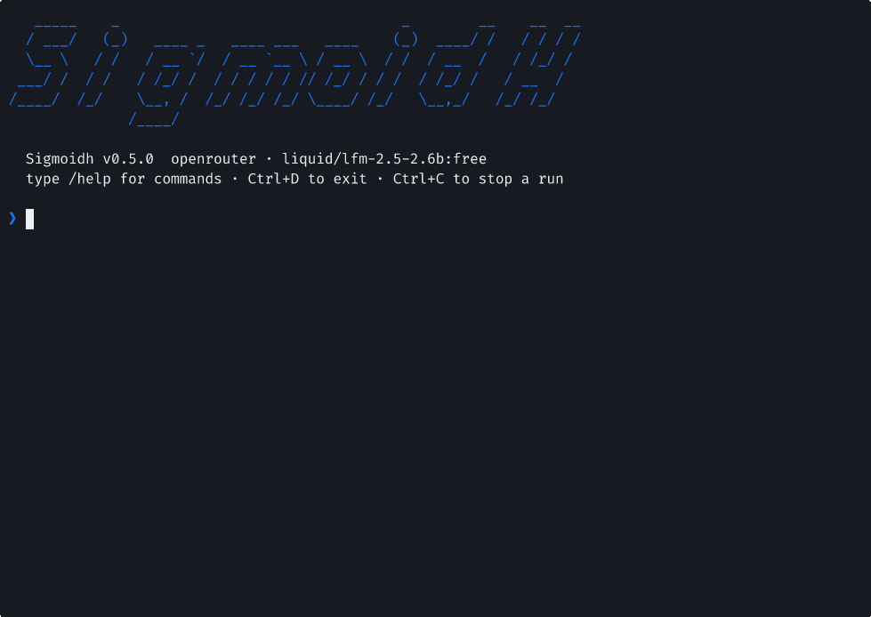
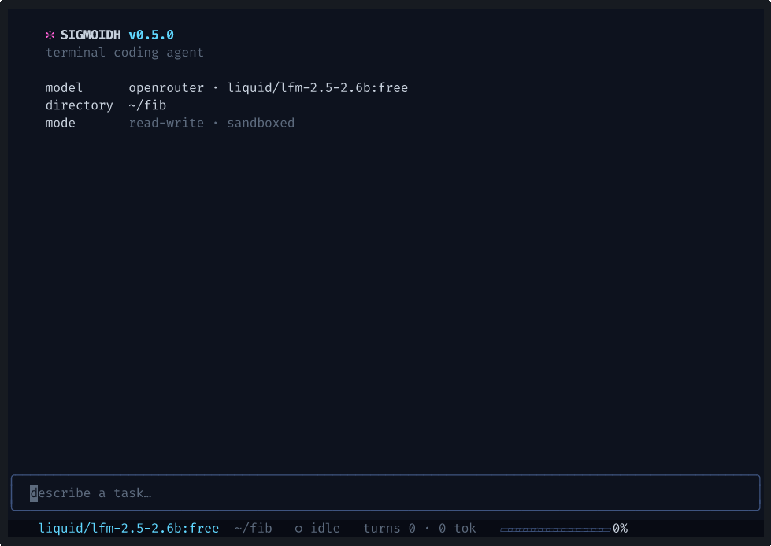

# Sigmoidh

Simple Terminal coding agent in Go - CLI, full-screen TUI, and a JSON event stream for scripts.

| CLI | TUI (`-tui`) |
|---|---|
|  |  |

<sub>Unedited runs on `liquid/lfm-2.5-2.6b:free` on OpenRouter. Recorded with `demo/record.sh`</sub>

## Build

```bash
go mod tidy
go build -o sigmoidh ./cmd/sigmoidh
```

## Run


```bash
./sigmoidh                                        # Interactive CLI
./sigmoidh -tui                                   # TUI
./sigmoidh "fix the failing test"                 # One-shot prompt
./sigmoidh -json "summarize main.go" | jq .       # JSONL events
```

- API keys: `~/.sigmoidh/.env` / `$PWD/.env` / `SIGMOIDH_ENV_FILE=/path/.env`
- Useful flags: `-provider`, `-model`, `-readonly`, `-session <id>`, `-list-sessions`.
- Help: CLI - `-help`, Slash-commands - `/help`.

### Tools

```bash
./sigmoidh -list-tools
```

### Evals

```bash
./sigmoidh -eval-tasks demo/evals/tasks.json -eval-runs 2 -provider groq
```

Runs tasks against fixture copies in a Bubblewrap sandbox and reports pass rate, turns, tool calls, errors, and token usage. Per-run logs are stored as JSONL.

## Tests

Tests run dangerous commands such as `rm -rf`, so running commands in a container is must.

1. Build container
```
docker build  -t sigmoidh-test . -f Dockerfile.test
```

2. Use `test.sh` 

This runs test suite in a Docker container with a shared volume, so go does not fetch modules again and again. 
```
chmod +x test.sh
./test.sh
```

In case modules were updated, repeat Steps 1 and 2.

## Supported Providers

| `-provider` | API key Variables |
|---|---|
| `openrouter` (default) | `OPENROUTER_API_KEY` |
| `anthropic` | `ANTHROPIC_API_KEY` |
| `openai` | `OPENAI_API_KEY` |
| `gemini` | `GEMINI_API_KEY` / `GOOGLE_API_KEY` |
| `groq` | `GROQ_API_KEY` |

Extra accounts: Add accounts as `<VAR>_ACC_1`, `<VAR>_ACC_2`, etc. Rate-limited keys fall back to other configured accounts and providers.


> **Note:** the Minecraft-themed [website](https://adityabavadekar.github.io/sigmoidh) was itself built by Sigmoidh running the `ox-alpha` model via OpenRouter.

## License

Licensed under the [Apache License 2.0](LICENSE).