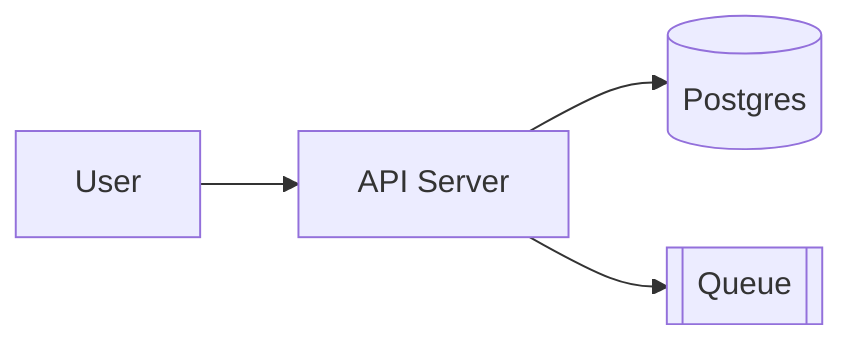

# Diagrams

Always produce a **rendered** diagram — Mermaid/code, or a standalone HTML+SVG file.
Never answer with ASCII art.

## Choose the form

| Subject | Tool |
|---------|------|
| Flow, sequence, state, ER, class, gantt | **Mermaid** (default) |
| Dependency / network graphs, auto-layout | **Graphviz** `dot` |
| UML-heavy | **PlantUML** (needs Java) |
| Modern, clean | **d2** |
| Infra / cloud / service topology you can style | **HTML + inline SVG** (below) |

## Mermaid

```bash
mmdc -i d.mmd -o d.svg -t neutral --width 1600
```

````markdown

````

Also renders directly in GitHub/Markdown fenced blocks. Gotchas: quote labels
containing punctuation (`:` `(` `"`); long labels break layout; set direction
explicitly (`TD`/`LR`); group with `subgraph`.

## Graphviz / d2

```bash
dot -Tsvg d.dot -o d.svg     # -Tpng for raster
d2 in.d2 out.svg
```

## HTML architecture diagram (dark, infra)

A single self-contained `.html` with inline CSS+SVG, no JS, opens in any browser.
Best for cloud/VPC/microservice topology. Save as `<project>-architecture.html`.

Semantic palette (fill / stroke):

| Type | Fill | Stroke |
|------|------|--------|
| Frontend | `rgba(8,51,68,.4)` | `#22d3ee` |
| Backend | `rgba(6,78,59,.4)` | `#34d399` |
| Database | `rgba(76,29,149,.4)` | `#a78bfa` |
| Cloud/AWS | `rgba(120,53,15,.3)` | `#fbbf24` |
| Security | `rgba(136,19,55,.4)` | `#fb7185` |
| Message bus | `rgba(251,146,60,.3)` | `#fb923c` |
| External | `rgba(30,41,59,.5)` | `#94a3b8` |

Background `#020617` with a 40px grid; JetBrains Mono; rounded boxes `rx=6`.

Rules: draw arrows **early** (behind boxes); use **double-rect masking** (opaque
`#0f172a` rect, then the translucent styled rect) so arrows don't show through;
arrowheads via an SVG `<marker>`; security groups dashed rose, regions dashed
amber (`stroke-dasharray="8,4"`); place the legend **outside every boundary**;
keep ≥40px vertical gaps.

Minimal skeleton to extend:

```html
<!DOCTYPE html><html><head><meta charset="utf-8"><style>
body{font-family:'JetBrains Mono',monospace;background:#020617;color:#fff;padding:2rem}
.box{}.sw{display:inline-block;width:16px;height:10px;border-radius:2px}
</style></head><body>
<svg viewBox="0 0 1000 600" style="width:100%;min-width:900px">
  <defs>
    <marker id="a" markerWidth="10" markerHeight="7" refX="9" refY="3.5" orient="auto">
      <polygon points="0 0,10 3.5,0 7" fill="#64748b"/></marker>
    <pattern id="grid" width="40" height="40" patternUnits="userSpaceOnUse">
      <path d="M40 0 L0 0 0 40" fill="none" stroke="#1e293b" stroke-width=".5"/></pattern>
  </defs>
  <rect width="100%" height="100%" fill="url(#grid)"/>
  <!-- arrows first, then boxes (opaque rect + translucent rect + labels) -->
  <line x1="130" y1="140" x2="300" y2="140" stroke="#22d3ee" stroke-width="1.5" marker-end="url(#a)"/>
  <rect x="300" y="115" width="140" height="50" rx="6" fill="#0f172a"/>
  <rect x="300" y="115" width="140" height="50" rx="6" fill="rgba(6,78,59,.4)" stroke="#34d399" stroke-width="1.5"/>
  <text x="370" y="137" fill="#fff" font-size="11" font-weight="600" text-anchor="middle">API Server</text>
  <text x="370" y="153" fill="#94a3b8" font-size="9" text-anchor="middle">FastAPI :8000</text>
</svg>
</body></html>
```

## Verify

- Mermaid/Graphviz: render, then open the SVG/PNG; check for clipped or overlapping nodes.
- HTML: screenshot and look at it —
  `chromium --headless --screenshot=arch.png --window-size=1280,900 file://$PWD/arch.html`.
